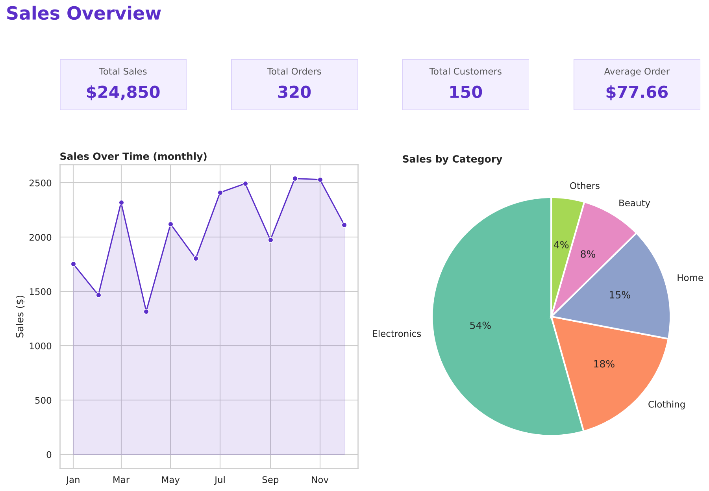
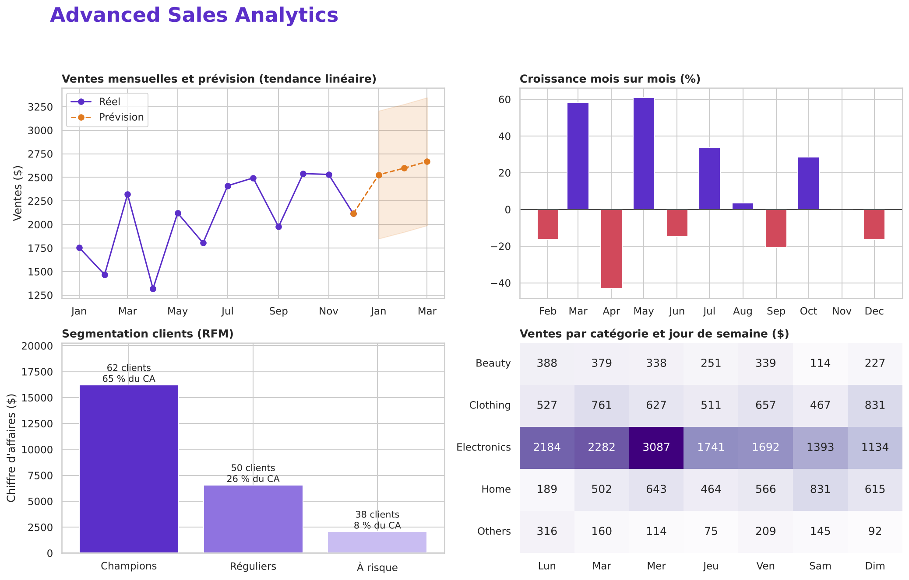

# Data Analytics Dashboard

Analyse d'un jeu de données de ventes avec **Python, Pandas, Matplotlib, Seaborn** (+ Streamlit et Plotly pour la version interactive).



## Contenu
| Fichier | Rôle |
|---|---|
| `generate_data.py` | Génère `sales.csv` (320 commandes, 150 clients, 24 850 $) |
| `analytics_dashboard.py` | Nettoyage, KPIs, `dashboard.png` |
| `advanced_analysis.py` | Croissance, prévision à 3 mois, segmentation RFM, heatmap jour × catégorie, `dashboard_advanced.png` |
| `app.py` | Application interactive Streamlit (filtres date/catégorie, upload CSV, export) |

## Utilisation
```bash
pip install pandas numpy matplotlib seaborn streamlit plotly
python generate_data.py
python analytics_dashboard.py
python advanced_analysis.py        # ou : python advanced_analysis.py mon_fichier.csv
streamlit run app.py
```
Format CSV attendu : `order_id, date, customer_id, category, amount`.

## Résultats clés (données fictives)
- Ventes : 24 850 $ | Panier moyen : 77,66 $ | Electronics = 54 % du CA
- Les « Champions » RFM (62 clients) génèrent 65 % du CA ; les 20 % meilleurs clients font 43 %
- Meilleur jour : mercredi | Tendance : environ +70 $ de ventes par mois

## Limites
La prévision est une simple régression linéaire sur 12 points : à lire comme un ordre de grandeur (intervalle large), pas comme une promesse.
